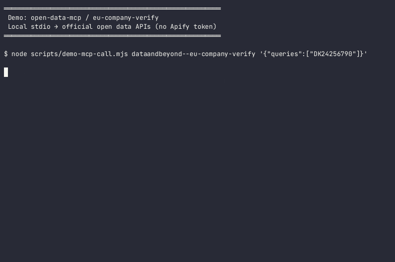
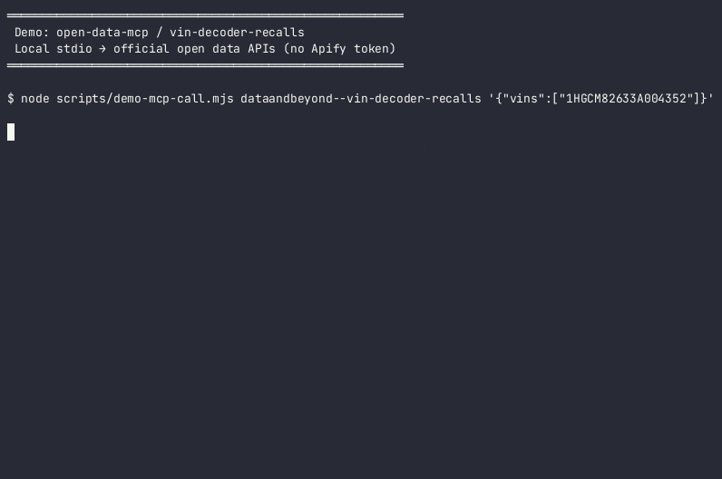
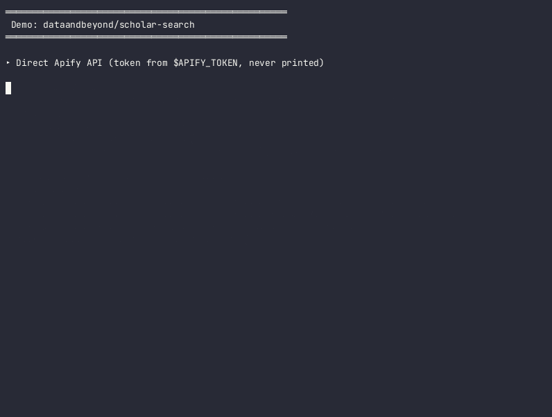

# open-data-mcp

[](https://glama.ai/mcp/servers/markatdataandbeyond/open-data-mcp)

Ten Apify Actors from Data and Beyond ApS that wrap official open-data APIs. They can be called from Claude, Cursor, VS Code or any other MCP client through the [Apify MCP server](https://docs.apify.com/platform/integrations/mcp), or directly over the Apify API.

This repository holds documentation, client configuration, and a small stdio MCP proxy (Dockerfile + `glama.json`) for local or Glama use. The Actor code itself runs on Apify. The proxy lists the ten tools without a token; tool calls forward to `https://mcp.apify.com` with the caller's `APIFY_TOKEN`.

## The Actors

Prices are pay-per-event in USD, charged by Apify.

| Actor | Data source | Price (USD) |
|---|---|---|
| [eu-company-verify](https://apify.com/dataandbeyond/eu-company-verify) | EU VAT number check in VIES, plus LEI and parent companies from GLEIF, in one call | 0.004 per company verified |
| [dk-statistics](https://apify.com/dataandbeyond/dk-statistics) | Statistics Denmark (Statbank): search tables, see variables, fetch rows as JSON | 0.003 per table described + 0.002 per 100 rows |
| [scholar-search](https://apify.com/dataandbeyond/scholar-search) | Academic papers from OpenAlex, Crossref and arXiv, ranked by relevance and citations | 0.002 per paper |
| [pubmed-search](https://apify.com/dataandbeyond/pubmed-search) | PubMed search with articles, DOI, PMCID and authors (NCBI E-utilities) | 0.002 per article |
| [eu-tenders](https://apify.com/dataandbeyond/eu-tenders) | EU public procurement notices from TED: buyer, deadline, value and winners | 0.003 per tender notice |
| [france-company-search](https://apify.com/dataandbeyond/france-company-search) | French companies by name, SIREN or SIRET (Sirene), with computed VAT number | 0.003 per company |
| [nordic-company-registry](https://apify.com/dataandbeyond/nordic-company-registry) | Norwegian (Brønnøysund) and Finnish (PRH/YTJ) companies in one schema | 0.003 per company |
| [clinical-trials](https://apify.com/dataandbeyond/clinical-trials) | ClinicalTrials.gov search by condition, intervention, sponsor, phase or NCT ID | 0.003 per trial |
| [vin-decoder-recalls](https://apify.com/dataandbeyond/vin-decoder-recalls) | Bulk VIN decoding and NHTSA recall check | 0.001 per VIN decoded, 0.003 with recall check |
| [weather-forecast](https://apify.com/dataandbeyond/weather-forecast) | MET Norway forecasts for a place name or coordinates, hourly or daily, up to 10 days | 0.001 per forecast |

## Setup

You need an Apify account and an API token from https://console.apify.com/settings/integrations. Replace `<APIFY_TOKEN>` in the config with your token, and keep the token out of version control.

- Cursor: [examples/cursor.json](examples/cursor.json) goes in `.cursor/mcp.json` or `~/.cursor/mcp.json`.
- Claude Desktop: [examples/claude-desktop.json](examples/claude-desktop.json) uses `mcp-remote` to connect to the remote server.
- VS Code: [examples/vscode.json](examples/vscode.json) goes in `.vscode/mcp.json`.
- Other clients: point a streamable HTTP connection at the URL below with the header `Authorization: Bearer <APIFY_TOKEN>`.

```
https://mcp.apify.com/?tools=dataandbeyond/eu-company-verify,dataandbeyond/dk-statistics,dataandbeyond/scholar-search,dataandbeyond/pubmed-search,dataandbeyond/eu-tenders,dataandbeyond/france-company-search,dataandbeyond/nordic-company-registry,dataandbeyond/clinical-trials,dataandbeyond/vin-decoder-recalls,dataandbeyond/weather-forecast
```

To load fewer tools, remove Actors from the `tools=` list.

## Without MCP

```bash
curl -X POST "https://api.apify.com/v2/acts/dataandbeyond~weather-forecast/run-sync-get-dataset-items" \
  -H "Authorization: Bearer $APIFY_TOKEN" -H "Content-Type: application/json" \
  -d '{"locations": ["Copenhagen"]}'
```


## Demo

Short terminal recordings of three Actors — direct Apify API and via this repo's MCP stdio proxy. Token values are never printed (`$APIFY_TOKEN` only).

| Actor | GIF | Screenshot |
|---|---|---|
| [eu-company-verify](https://apify.com/dataandbeyond/eu-company-verify) |  | [PNG](assets/demo/eu-company-verify.png) |
| [vin-decoder-recalls](https://apify.com/dataandbeyond/vin-decoder-recalls) |  | [PNG](assets/demo/vin-decoder-recalls.png) |
| [scholar-search](https://apify.com/dataandbeyond/scholar-search) |  | [PNG](assets/demo/scholar-search.png) |

Raw GitHub URLs (for Store READMEs):

- `https://raw.githubusercontent.com/markatdataandbeyond/open-data-mcp/main/assets/demo/eu-company-verify.gif`
- `https://raw.githubusercontent.com/markatdataandbeyond/open-data-mcp/main/assets/demo/vin-decoder-recalls.gif`
- `https://raw.githubusercontent.com/markatdataandbeyond/open-data-mcp/main/assets/demo/scholar-search.gif`

Replay a cast locally with [asciinema](https://asciinema.org/): `asciinema play assets/demo/eu-company-verify.cast`. Re-record with `APIFY_TOKEN=… bash scripts/record-demos.sh` (never commit the token).

## Notes

- On Apify's free plan, run one Actor at a time. Several parallel runs can fail with HTTP 402.
- Each Actor's Store page lists its data source and the source's license.

## License

The documentation and configuration in this repository are MIT licensed. See [LICENSE](LICENSE).
